<h1 align="center">Hi there, I'm EDAN 👋</h1>

<i>Curious coder · Tech enthusiast · Aspiring SecDev · InfoSec</i>

<picture>
<source media="(prefers-color-scheme: dark)" srcset="https://raw.githubusercontent.com/vedantdev37/vedantdev37/output/github-contribution-grid-snake-dark.svg">
<source media="(prefers-color-scheme: light)" srcset="https://raw.githubusercontent.com/vedantdev37/vedantdev37/output/github-contribution-grid-snake.svg">

</picture>

🤖 Card regenerated daily with Python + GitHub Actions.

