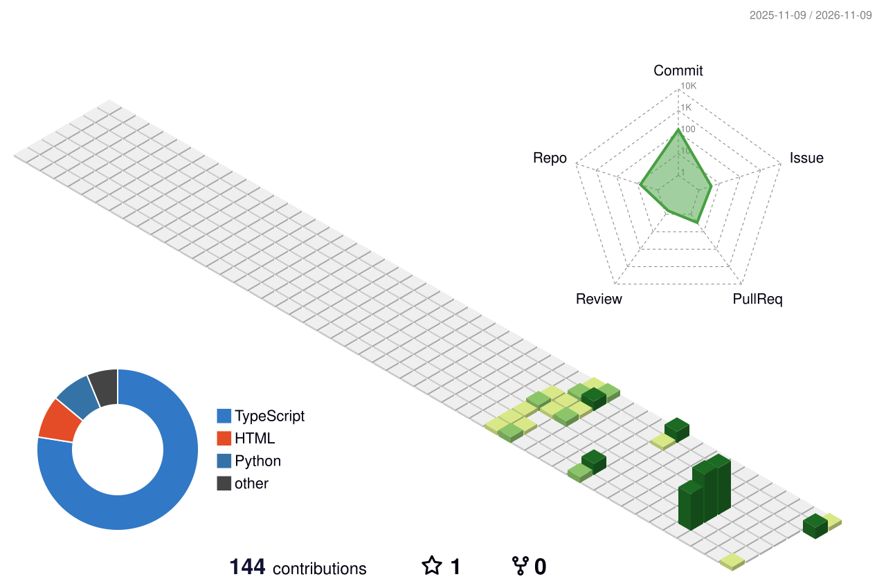
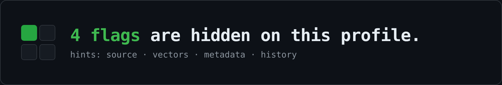

<h1 align="center">Hi there, I'm EDAN 👋</h1>
<p align="center"><i>Curious coder · Tech enthusiast · Aspiring SecDev · InfoSec</i></p>

<p align="center">

</p>

<div align="center">
<picture>
<source media="(prefers-color-scheme: dark)" srcset="https://raw.githubusercontent.com/vedantdev37/vedantdev37/output/pacman-contribution-graph-dark.svg">
<source media="(prefers-color-scheme: light)" srcset="https://raw.githubusercontent.com/vedantdev37/vedantdev37/output/pacman-contribution-graph.svg">

</picture>
</div>

<div align="center">
<picture>
<source media="(prefers-color-scheme: dark)" srcset="profile-3d-contrib/profile-night-rainbow.svg">
<source media="(prefers-color-scheme: light)" srcset="profile-3d-contrib/profile-green-animate.svg">

</picture>
</div>

## 🏴 Capture the flag

<p align="center"></p>

Found one? **Don't post the flag.** Post a hash that only works for you:

```sh
echo -n "yourusername:FLAG{...}" | sha256sum
```

Then [open an issue](https://github.com/vedantdev37/vedantdev37/issues/new?title=flag+) titled `flag <that hash>`. A bot checks it, replies, and adds you below.

<!-- RkxBR3t2MTN3X3RoM19zMHVyYzNfYmY2NDkxfQ== -->

### Hall of Fame

<!-- HOF:START -->
_No one has found a flag yet. Be the first._
<!-- HOF:END -->

<p align="center"><sub>🤖 Card, graphs and Hall of Fame are all regenerated by GitHub Actions.</sub></p>
