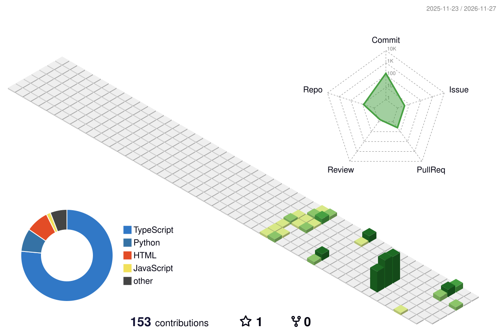

<h1 align="center">Hi there, I'm EDAN 👋</h1>

<i>Curious coder · Tech enthusiast · Aspiring SecDev · InfoSec</i>

<picture>
<source media="(prefers-color-scheme: dark)" srcset="https://raw.githubusercontent.com/vedantdev37/vedantdev37/output/pacman-contribution-graph-dark.svg">
<source media="(prefers-color-scheme: light)" srcset="https://raw.githubusercontent.com/vedantdev37/vedantdev37/output/pacman-contribution-graph.svg">

</picture>

<picture>
<source media="(prefers-color-scheme: dark)" srcset="profile-3d-contrib/profile-night-rainbow.svg">
<source media="(prefers-color-scheme: light)" srcset="profile-3d-contrib/profile-green-animate.svg">

</picture>

🤖 Card and graphs are regenerated daily by GitHub Actions.

